# Unbroken Ages

*One people. Every age.* An original turn-based 4X game that keeps the systems Civilization VI players
love (districts and adjacency, separate tech and civic trees, loyalty, governors, climate and power,
builders with charges), adds the features players have asked for over the years, and does not adopt
Civilization VII's age resets or civ-swapping.

> **Working title.** Every name, civilization ability, governor, district name and asset in this
> project is original. Civilization VI is cited only as the design reference point the brief calls
> for. See the IP note in [the GDD appendix](docs/01-game-design-document.md#appendix-b--naming--ip-hygiene).

## What's in this repository

| Path | What it is |
|---|---|
| [`docs/`](docs/) | The seven design deliverables (vision → architecture → schemas → plan → systems → UI → modding) |
| [`src/UnbrokenAges.Sim`](src/UnbrokenAges.Sim) | **Deterministic simulation core** (pure C#/.NET 8, no engine types, no floats) |
| [`src/UnbrokenAges.Net`](src/UnbrokenAges.Net) | **Multiplayer layer**: Direct IP TCP transport, LAN discovery, authoritative host and client sessions |
| [`content/base`](content/base) | The base game, written as a mod in JSON (districts, adjacency, governors, power plants, climate…) |
| [`content/schemas`](content/schemas) | JSON Schemas for content files and `mod.json` (editor autocomplete and validation) |
| [`mods/example-river-trade`](mods/example-river-trade) | Example mod showing add / patch / `$append` against the base game |
| [`godot/`](godot) | Godot 4.3 (.NET) presentation client: hex map renderer with civ and war borders, placement lens, city panel and production queue, combat preview tooltip, diplomacy screen, victory screen, Chronicle, Divergence screen, lobby |
| [`tools/UnbrokenAges.Tools`](tools/UnbrokenAges.Tools) | `ua` CLI: map preview, mod validator, headless soak sim, dedicated server, bot client |
| [`tests/`](tests) | 314 tests: systems, determinism, snapshots, mods, real-socket multiplayer, the Divergence, world ages, supply, industry, chronicle |

## Implemented and tested so far (milestone M0, "foundations")

* **District adjacency and placement**: data-driven rules, unique-district inheritance, provided adjacency
  (e.g. the Civic Plaza), "N more for +1" hints, neighbour deltas, a planner shared by the AI and the placement lens.
* **Production queue**: tile reservations for queued districts, partial progress kept when reordering, overflow,
  repeat items, invalid items skipped with a notification, per-item completion-turn estimates, gold purchase.
* **Loyalty and governors**: the documented pressure formula with a breakdown and turns-to-flip, Free Cities,
  a settling-in grace period; 8 original governors with promotion trees and establishment time.
* **Power and climate**: union-find power grids, merit-order dispatch (renewables first), fuel stockpiles,
  CO₂ → temperature with thermal lag → 7 phases → sea-level bands, flood barriers, disasters, forest carbon sinks.
* **Map generation with navigable rivers**: Great River channel tiles that boats can sail inland, plus classic
  edge rivers traced on the hex-corner graph, floodplains, lakes, lowlands, resources, start positions.
* **The Divergence (Future-era tech fork)**: after *the Threshold*, commit to **Sovereign**, **Symbiont** or **Discarnate**, and the other branches lock forever.
  Your history makes one doctrine cheaper. Each future remakes the Earth (engineered grids, a bioluminescent Bloom that crosses borders, black Substrate) and ends in
  an Ascension victory. See [08-divergence-tech-tree.md](docs/08-divergence-tech-tree.md) and run `ua future`.
* **Depth from Millennia & Shadow Empire, with Civ's ease** ([09](docs/09-genre-defining-depth.md)): **World Currents & Ages**
  (Progress, Strife and Calamity steer each era into an Age of Iron, Ash, Lanterns, Titans or Concord for the whole world; no civ swaps), a **supply lens** (rivers are
  highways; cut-off armies suffer attrition), **industries** (Steel, Plastics, Electronics, fully automatic), and **the Chronicle**, an auto-written dated history.
* **Diplomacy core**: war, peace, denunciation, open borders, closed borders for armies, itemized decaying grievances, and attitudes shown as named lines
  ([05/08](docs/05-key-systems/08-diplomacy.md)).
* **Combat v1**: melee and ranged attacks, terrain, rivers, fortification, flanking, unit counters, besieging and capturing cities, and a preview
  that lists every modifier ([05/09](docs/05-key-systems/09-combat.md)).
* **Border growth**: culture claims the most valuable adjacent tile (up to 5 out), or buy one with gold; the next tile is always previewed
  ([05/10](docs/05-key-systems/10-borders.md)).
* **Living Governors**: governors gain experience and earn up to three traits from where they serve ("River-wise", "Borderer",
  "Levee-builder"…), which travel with them ([05/02](docs/05-key-systems/02-loyalty-governors.md#living-governors-experience-and-traits)).
* **Outposts**: Waymakers plant cheap claims that hold land, extend supply and harvest one resource, with no city screen; buy one up into a
  city later ([05/12](docs/05-key-systems/12-outposts.md)).
* **38 nations and 94 leaders that play differently** ([05/14](docs/05-key-systems/14-nations.md)). Every nation plays one
  rule differently. Some examples:
  * Egypt grows in flood pulses from a royal granary.
  * Venice never trains Settlers, and buys outposts and cities instead.
  * Song rides a Mandate meter into golden dynasties.
  * Mongolia learns by conquest.
  * The Inca walk and farm the mountains.
  * Mali buys rather than builds.
  * Zulu armies strike from the horns.
  * Japanese units ignore their wounds.
  * Russia freezes invaders.
  * Portugal founds only on the coast.
  * Babylon learns by building.
  * The Haudenosaunee may never declare war.

  Each nation has two leaders whose augments bend that rule. Pick them in the lobby, which shows a dossier of how each plays.
* **Leaders of the World Wars** ([05/14](docs/05-key-systems/14-nations.md#leaders-of-the-world-wars)): 24 twentieth-century leaders,
  famous and infamous, with new nations **Germany** (Wilhelm II, Hitler) and **Italy** (Orlando, Mussolini). Mao and Chiang lead China,
  Lenin and Stalin lead Russia, and Franco leads Spain. They come
  with doctrines that change their nation's game, each pairing a large bonus with a real cost.
  * Churchill's fortress Britain, Stalin's Five-Year Plans, Tojo's expeditionary war cabinet.
  * Roosevelt's Arsenal of Democracy (isolation in peace, a war economy in war), Wilson's Fourteen Points, de Gaulle's Grandeur,
    Atatürk's Gallipoli, Ho Chi Minh's People's War.
  * Balanced against each nation's classic leader with a paired soak.

  | | |
  |---|---|
  | 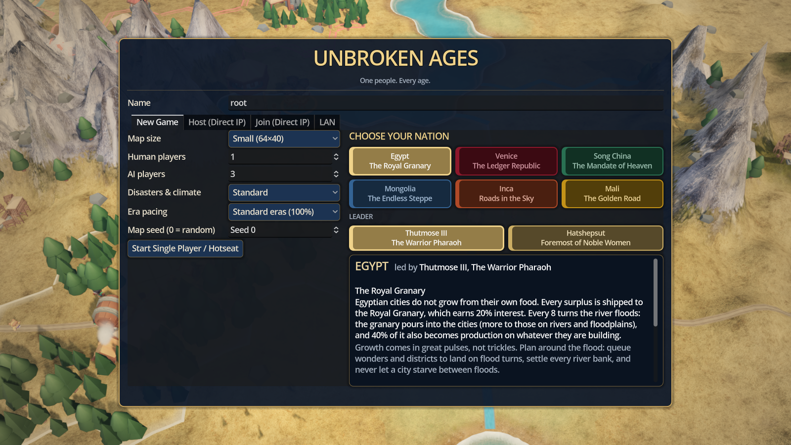 | 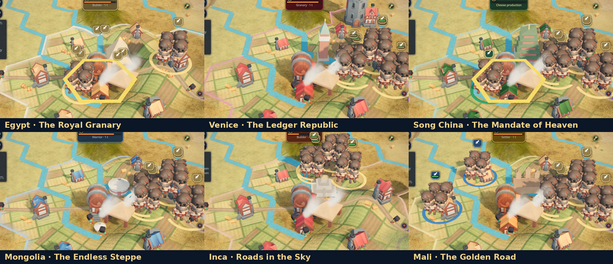 |
  | 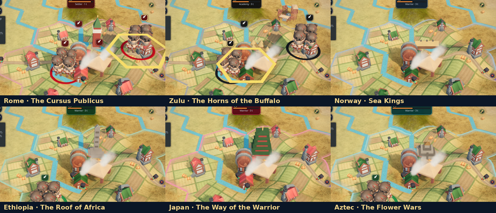 | |
* **Society** ([05/15](docs/05-key-systems/15-society.md)), on the Society screen (G):
  * **Governments and policy cards**: 11 governments and 24 cards in military, economic, diplomatic and wildcard slots.
  * **Faith**: pantheons, religions founded by Great Prophets with founder and follower beliefs, spread by pressure and by
    missionaries, and a **Spiritual victory**.
  * **Great people**: 30 historical figures, recruited by the first to earn them.
  * **Ages**: era score decides Golden, Dark and Heroic ages.
  * **Promotions**: units earn experience and choose from 16 promotions.
  * **Barbarians**: camps send raiders who pillage but never take cities.
  * **Wonders**: 14 world wonders and 9 natural wonders, each with its own model.
  * **War weariness**: makes endless conquest costly.

  | | |
  |---|---|
  | 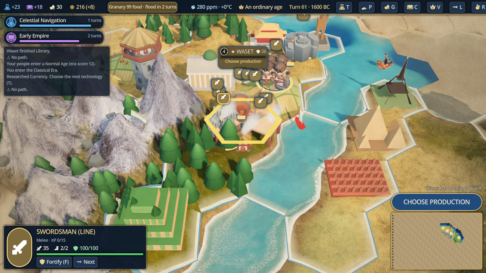 | 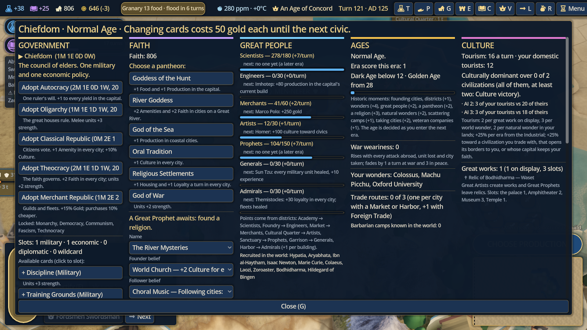 |
  | 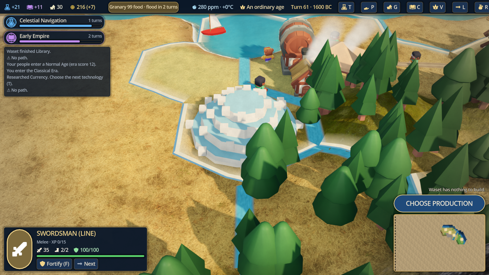 | 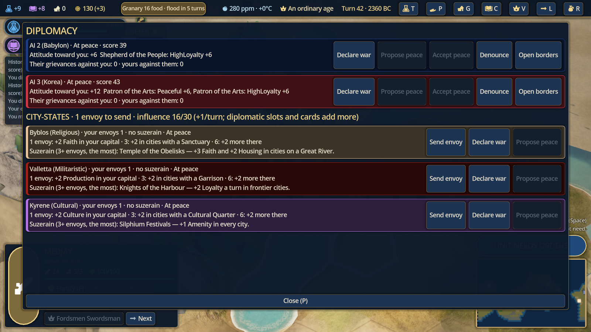 |
* **City-states** ([05/16](docs/05-key-systems/16-city-states.md)): 18 minor powers of six types, each its own player.
  * Influence buys envoys. 1, 3 and 6 envoys pay the type's yield in your capital and district cities.
  * The suzerain (the most envoys, at least 3) gets each city-state's unique bonus.
  * City-states keep pace with the world, defend themselves and accept peace.
* **Trade routes** ([05/17](docs/05-key-systems/17-trade.md)): Traders open 30-turn routes to cities within 15 tiles by land or
  20 by sea.
  * Domestic routes bring Food and Production. International routes bring Gold to both sides, plus Science and Culture.
    City-state routes bring Gold and influence.
  * Wars end routes, and enemies standing on a road plunder them.
  * Caravans and merchantmen travel the real routes on the map.
* **Espionage** ([05/18](docs/05-key-systems/18-espionage.md)): spies rise from Recruit to Master Spy.
  * Missions: steal technology, siphon funds, sabotage production, incite unrest, fabricate scandals in city-states, or guard your
    own cities.
  * Odds are shown up front. Caught spies are lost and cause a diplomatic incident. Use the Espionage screen (E).
* **Culture victory** ([05/19](docs/05-key-systems/19-culture.md)): Great Artists create named works (*The Iliad*, *Hamlet*, *The
  Great Wave*…) and Prophets leave relics.
  * Works hang in palaces, amphitheaters, museums and temples, and earn culture and tourism.
  * Wonders and natural wonders draw tourists too. Trade, open borders and a shared faith carry more of them.
  * Outnumber every rival's domestic tourists to win.
* **World Congress** ([05/20](docs/05-key-systems/20-congress.md)): it meets every 30 turns, and its resolutions are announced ten turns
  ahead.
  * Tallies are public. Diplomatic Favor buys extra votes.
  * Resolutions favour or punish a named civilization, or bind everyone (arms control, a climate accord).
  * Carrying votes and holding city-states earn diplomatic victory points; 20 win the **Concord** victory.

  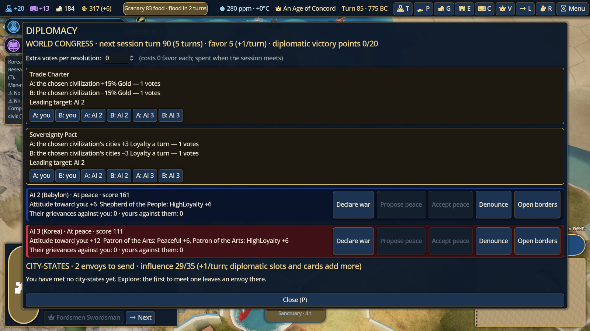
* **A line through every era** ([05/09](docs/05-key-systems/09-combat.md#the-line-through-the-ages)): Spearmen and Pikemen
  against cavalry, Knights, Musketmen, Line Infantry, Cavalry, Infantry, Mechanized Infantry and Modern Armor; Catapults, Field
  Cannon and Artillery that break walls; Battleships, Destroyers and Submarines; Fighters and Bombers that fly over any tile.
  Each unit upgrades along its line, and unique units follow the line of the unit they replace.
* **Unique units for all 38 nations, plus corps and armies**: the Legion, the Hoplite, the Impi, the Samurai, the Cossack, the Hwacha, the
  Winged Hussar, the Sherman and more. Two units of a kind merge into a Corps (+10) and then an Army (+17), and march in deeper ranks.
* **Space** ([05/21](docs/05-key-systems/21-space.md)): Spaceports launch survey, solar, weather and relay satellites that cover the
  cities below them for 40 turns.
  * The Exodus chain runs First Orbit, Moon Base, Mars Colony, then the Ark, which wins the **Exodus** victory.
  * Every victory type is now built.
* **Earth with true start locations** ([05/22](docs/05-key-systems/22-earth.md)): a detailed 128 × 80 real-world map built from
  Natural Earth, with real coastlines, mountain ranges, deserts, forests and 14 Great Rivers along their real courses. Every
  civilization starts at its historical capital, and every city-state and natural wonder stands at its real site. Land units
  embark to cross the sea (Sailing, then Celestial Navigation). `tools/maps/earth_soak.py` plays 12-civilization Earth games to
  turn 500 against eight targets (expansion, survival, balance, pace, decision, conflict, speed); after six rounds of fixes all
  eight hold across both tables of peoples ([results](docs/05-key-systems/22-earth.md#results-six-rounds-to-a-good-game)).

  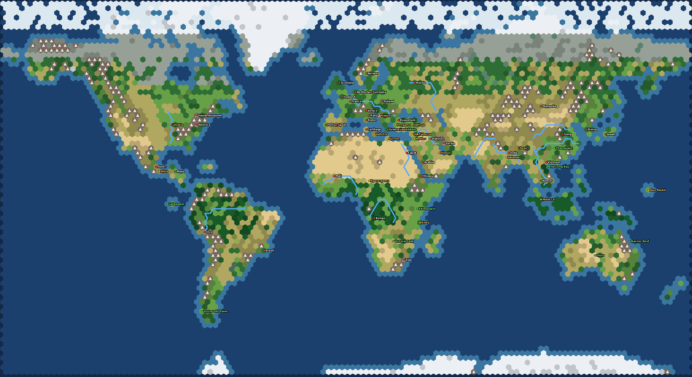
* **Unit variants**: upgrades offer 2–3 honest trade-offs (Heavy, Fordsmen, Longbow, Ram…), shown in the combat preview
  ([05/09](docs/05-key-systems/09-combat.md#unit-variants-and-upgrades)).
* **Victory**: Ascension, Hegemony (every original capital, or 60% of the world's people and land) and an itemized Score at the turn limit;
  each can be toggled; elimination; One More Turn ([05/11](docs/05-key-systems/11-victory.md)).
* **AI v2**: settles good sites, improves resources first, declares war on weaker neighbours, attacks only above 60% odds, pulls back
  wounded units and makes peace on sensible terms ([05/13](docs/05-key-systems/13-ai.md)).
* **Direct IP multiplayer**: dynamic turns (civilizations at peace move together, enemies alternate phases), authoritative sequencing, issuer rewriting (anti-spoofing), per-turn state hashes,
  automatic desync healing with snapshots, reconnect tokens, spectators, content-hash checks for mod mismatches, LAN beacons.

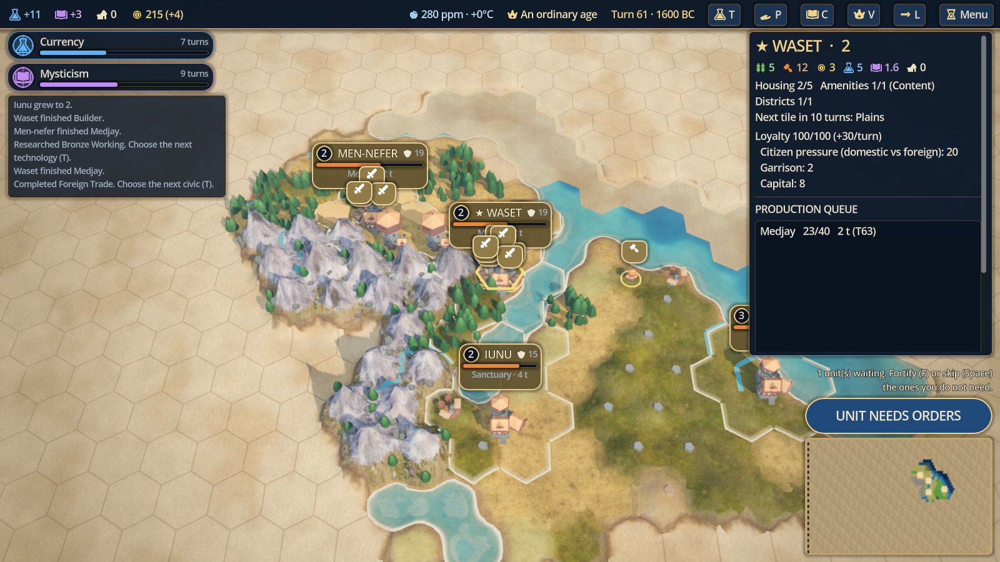

## Look and sound

**The latest pass** adds:
- a period look for every unit (riders on their mounts, tanks of each war, triremes to carriers);
- Renaissance towns and varied industrial and modern cities;
- woods of their climate;
- a research screen laid out as a tree, with planned paths;
- the selected unit's reach and route on the map;
- battles you can see: arrows and shells in flight, impacts, fire and smoke, damage numbers;
- notification cards, build cards in the city screen, and an advisor that teaches the first game.

| | |
|---|---|
| 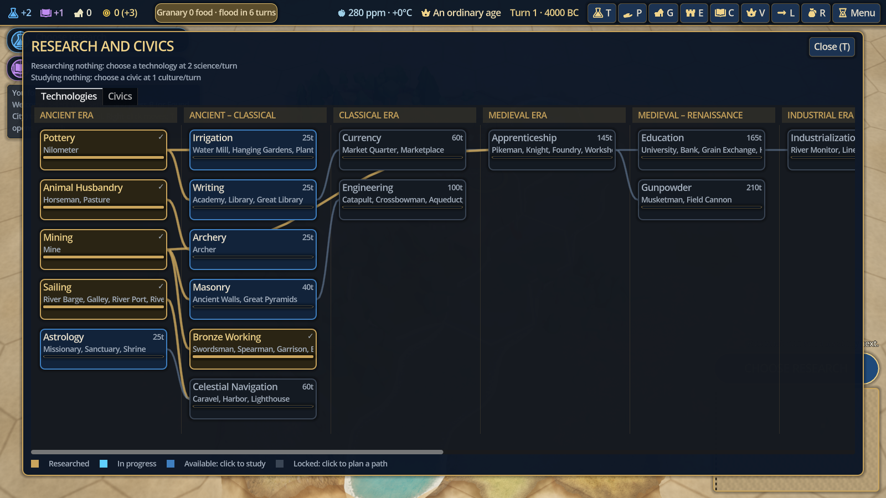 | 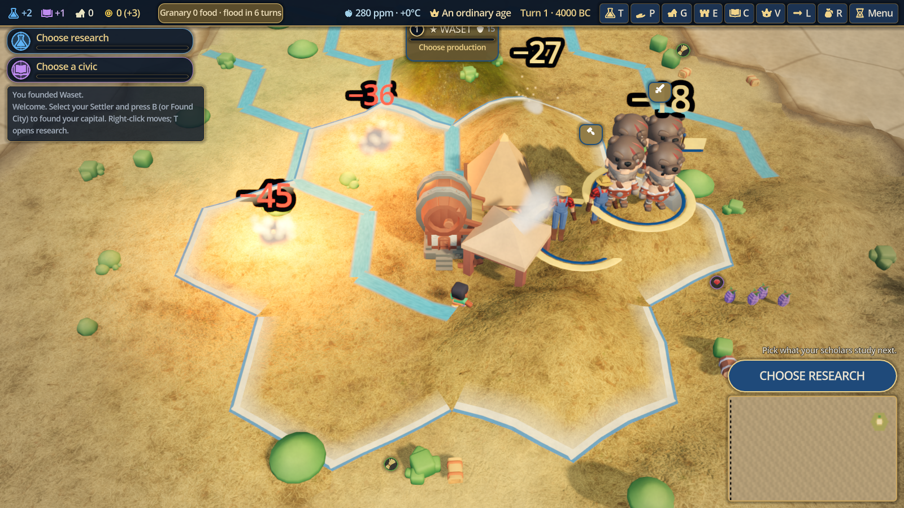 |
| 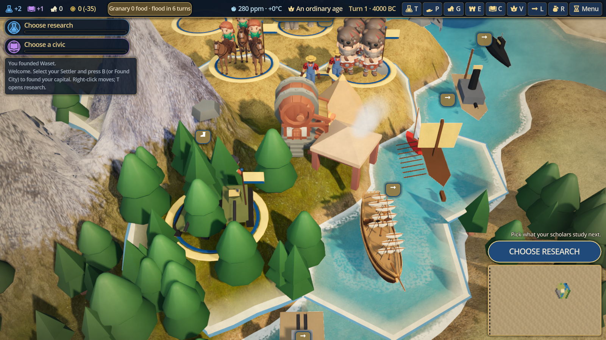 | 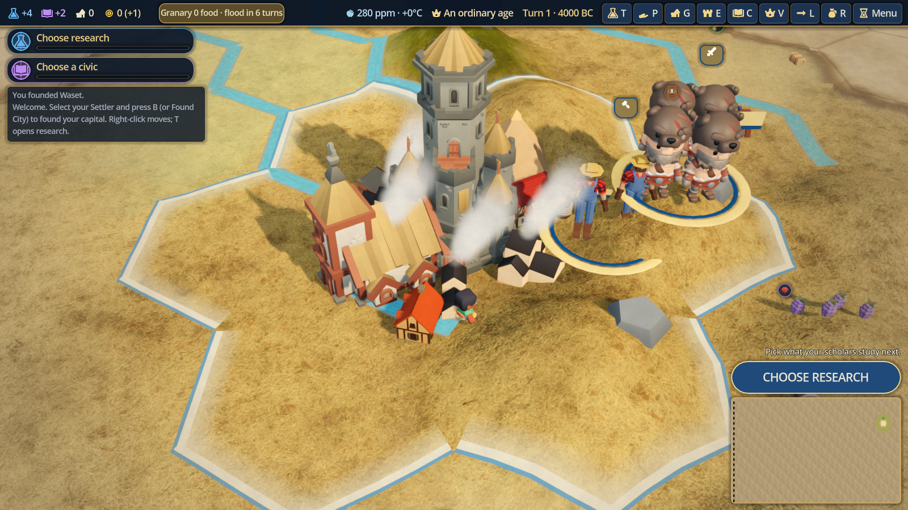 |
| 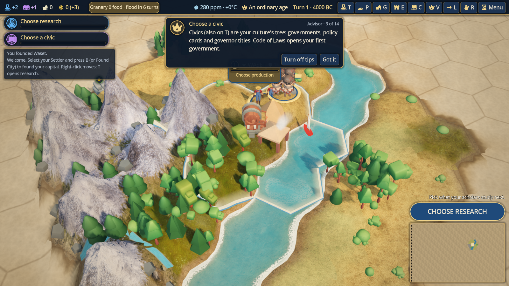 | 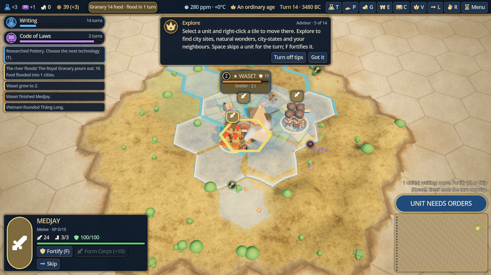 |


Civ VI's painted art direction on an old paper map ([06 §9](docs/06-ui-ux-wireframes.md#9-art-direction-a-painted-world-on-an-old-chart)):
terrains blend across soft, hand-painted borders; coasts have turquoise shallows, rolling surf and foam; forests, hills,
mountains, team-coloured cities and districts are 3D; units are animated squads of four. The world is alive: farms are
patchworks of crop plots, roads link your cities with wagons (later cars and lorries) carrying the harvest, fishing boats
work the coasts, cattle and horses graze, birds wheel overhead and every chimney smokes. Every resource stands on its tile,
and the resource lens (R) shows what each one yields and whether it is improved. What a civilization builds follows
**only the technologies it has researched**: tents become stone keeps, walled burghs, factory towns with coal stacks and
then skylines; footpaths become cobbles, macadam, asphalt and smart roads; carts become lorries, cars and autonomous pods.
At the top of the tree the three Divergence futures look nothing alike: Sovereign (destructive) white arcologies and
bastions, Symbiont (harmonized) cities grown around great luminous trees, Discarnate (syncretic) black monoliths lit violet
with hovercraft and drones. The unexplored world is an inked parchment
chart, places you have seen but cannot see now are a sepia watercolour with cross-hatched scenery, and the frontier is a
burnt edge on the paper. The interface follows Civ V and VI: top bar with yield icons, research and civic trackers, city
banners and unit flags, a minimap and a turn button that names the next thing to do. Music, effects and a synthesised
wind-and-surf ambience. Every third-party asset is CC0 or CC-BY 4.0 and credited in
[`godot/assets/CREDITS.md`](godot/assets/CREDITS.md); `tools/assets/fetch_assets.py` re-downloads them from the manifest.

| | |
|---|---|
| 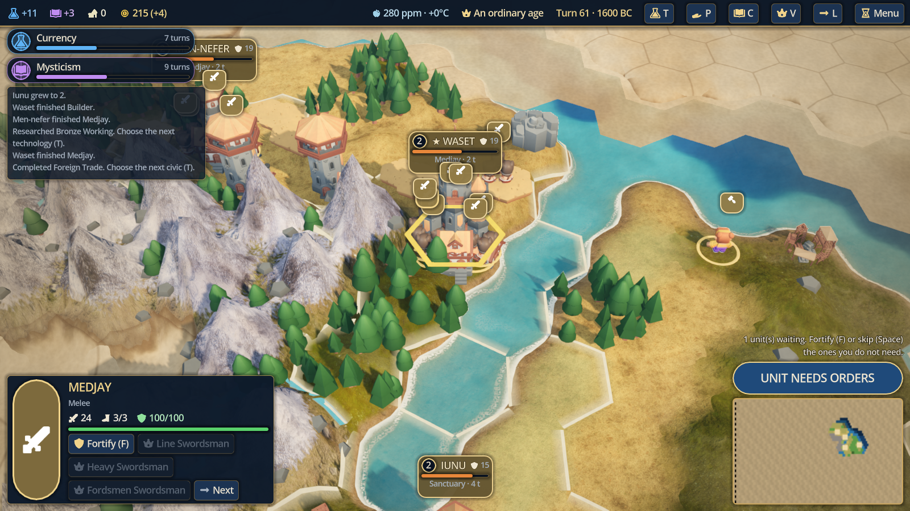 | 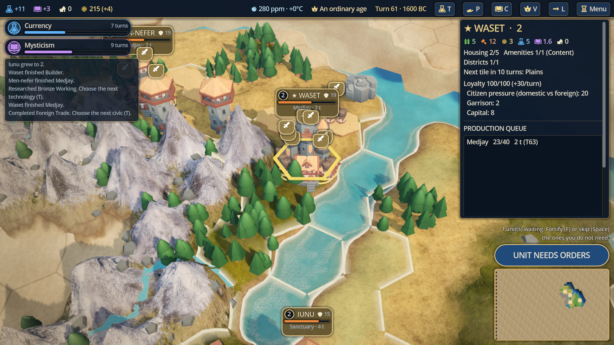 |
| 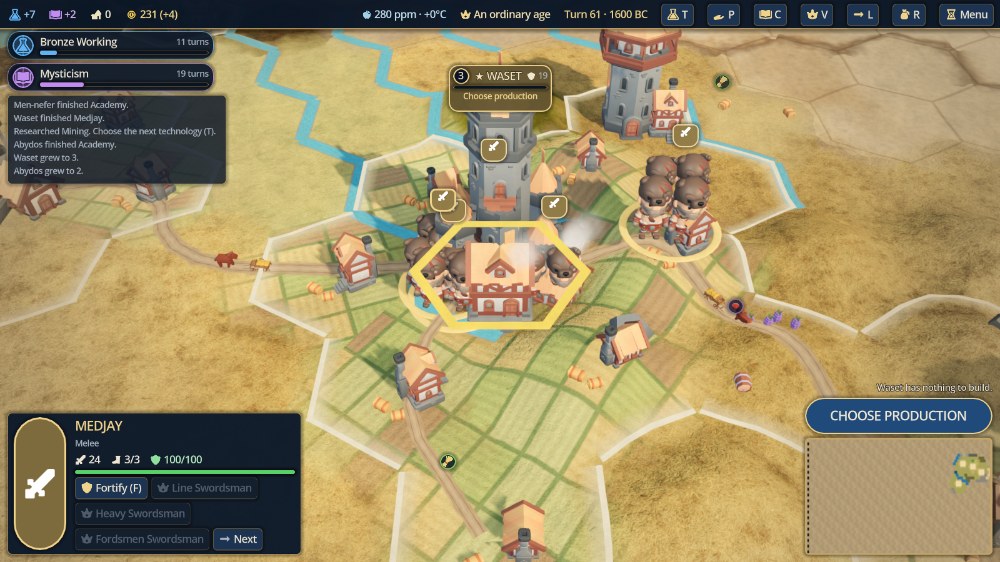 | 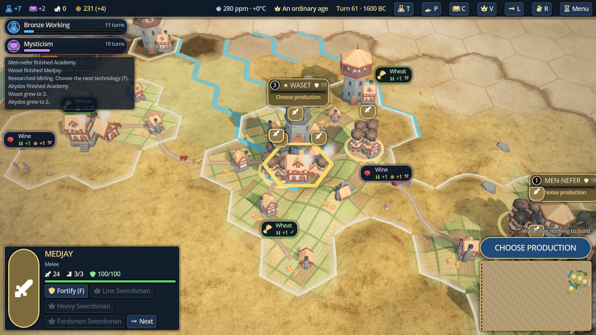 |
| 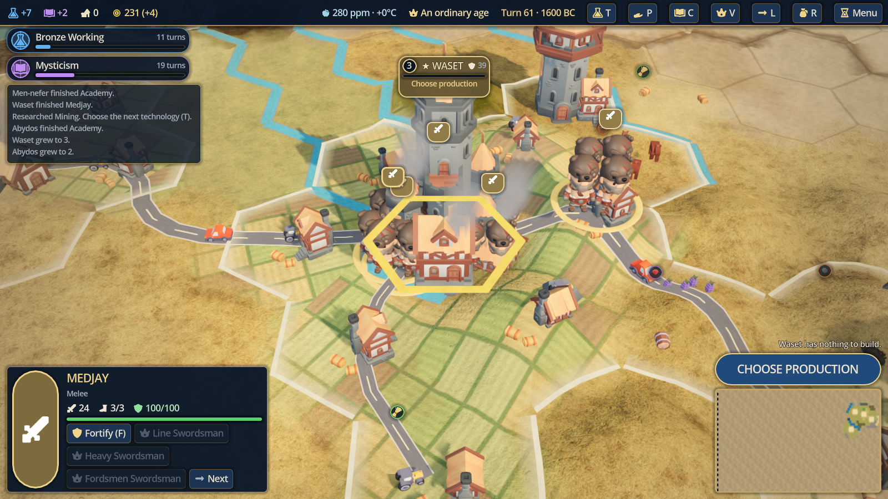 | 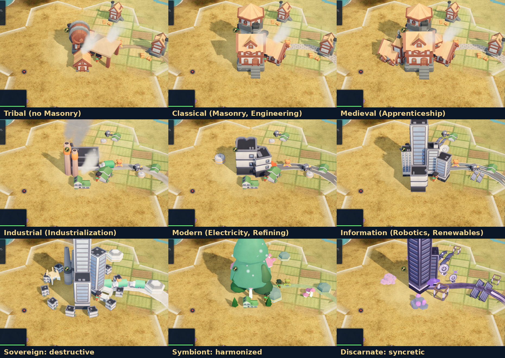 |

## Play it (first playable)

1. Install the [.NET 8 SDK](https://dotnet.microsoft.com/download) and **Godot 4.3, .NET edition**.
2. `dotnet build godot/UnbrokenAges.Client.csproj`, then open `godot/project.godot` in Godot and press Play (F5).
3. In the lobby choose **Single player** and **Launch**. Your Settler is selected: press **B** to found your capital.

| Do this | How |
|---|---|
| Select a unit or city | Left-click (click a city again to cycle through the units inside) |
| Move or attack | Right-click a tile (hovering an enemy shows the combat preview first) |
| Skip a unit for the turn · Found city · Fortify | Space · B · F (or the buttons in the unit panel) |
| Research and civics | T |
| City production | Click your city: queue, reorder, buy |
| End turn | Enter or the End Turn button (it names anything still waiting for you) |
| Diplomacy · Society · Espionage · Chronicle · Divergence · Supply lens · Resource lens | P · G · E · C · V · L · R |
| Save · Load | F5 · F9 |
| Pan · Zoom · Close a screen | WASD or arrows · mouse wheel · Esc |

**Playtesters: start with [docs/PLAYTEST.md](docs/PLAYTEST.md)** (recommended settings, every control, what to look at,
known limitations and how to report a problem). Fog of war hides what you have not explored. `tools/client-smoke.sh` plays 45 turns of the real client with scripted input and saves screenshots (it runs headless
with `xvfb-run` and a software Vulkan driver).

## Quick start

```bash
# .NET 8 SDK required
dotnet test                                        # 314 tests, ~4 s
dotnet run --project tools/UnbrokenAges.Tools -- mapgen --seed 7 --size MAPSIZE_STANDARD
dotnet run --project tools/UnbrokenAges.Tools -- simulate --turns 200 --players 4
dotnet run --project tools/UnbrokenAges.Tools -- validate mods/example-river-trade
dotnet run --project tools/UnbrokenAges.Tools -- future --turns 150     # three futures remake one continent

# Direct IP: a dedicated server and a headless bot client in two terminals
dotnet run --project tools/UnbrokenAges.Tools -- host --port 47620 --humans 1 --ai 2
dotnet run --project tools/UnbrokenAges.Tools -- join 127.0.0.1:47620 --name Bot

# Client: open godot/project.godot in Godot 4.3+ (.NET edition) and press Play.
```

## Documentation map

1. [Game Design Document](docs/01-game-design-document.md): vision, pillars, every system, community-request traceability
2. [Technical Architecture](docs/02-technical-architecture.md): engine choice, layering, determinism, networking, data, AI, performance
3. [Data Schemas](docs/03-data-schemas.md): every content type, with real examples and planned schemas
4. [Implementation Plan](docs/04-implementation-plan.md): milestones M0–M6, exit criteria, team, risks
5. [Key Systems](docs/05-key-systems/README.md): adjacency, loyalty and governors, climate and power, networking, production queue, map generation
6. [UI/UX Wireframes](docs/06-ui-ux-wireframes.md): city view, empire overview, diplomacy, tech tree, lobby, placement lens
7. [Modding](docs/07-modding.md): philosophy, layering, example mod, scripting sandbox, workshop
8. [The Divergence](docs/08-divergence-tech-tree.md): the Future-era tech fork (Sovereign / Symbiont / Discarnate) and the remade Earth
9. [Genre-Defining Depth](docs/09-genre-defining-depth.md): what we take from Millennia and Shadow Empire, held to Civ's ease (Ease Charter, Depth Dial)
