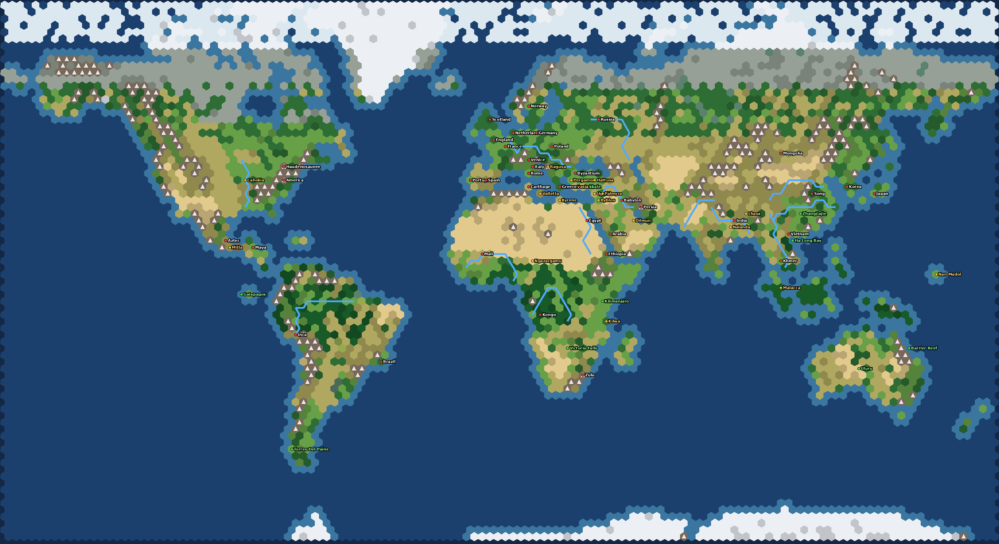

# 5.22 The Earth map and true start locations

## The map
`MAP_EARTH` is a 128 × 80 hex map (the Huge size), wrapping east–west, in a Miller projection from 80°N. Miller gives the crowded
Mediterranean, Europe and the Near East more room than a flat latitude grid would. It is built by `tools/maps/earth.py` from
[Natural Earth](https://www.naturalearthdata.com/) (public domain) and lives in `content/base/data/maps/earth.json` like any other
content, so mods can patch or replace it.

| Layer | Source |
|---|---|
| Land, sea, lakes | `ne_50m_land`, `ne_50m_lakes` (large lakes); each tile is sampled at 9 points. Narrow seas the grid would close (the Red Sea, the Strait of Gibraltar) are kept open, and small islands the game needs (Malta, Bahrain, Pohnpei, the Galápagos) are kept as one tile. |
| Snow, tundra | `ne_50m_glaciated_areas` (Greenland, Antarctica), latitude above 64° (72° for snow), Natural Earth's tundra regions |
| Mountains, hills | the 129 `Range/mtn` regions (Himalayas, Andes, Alps, Rockies, Atlas, Zagros, Urals...): mountains along each spine with passes, hills around it; plateaus (Tibet, Iran, Deccan, Anatolia...) and foothills are hilly |
| Deserts | the 35 `Desert` regions (Sahara, Arabia, Gobi, Taklimakan, Thar, Kalahari, Namib, Atacama, the Australian deserts...) and the dry basins |
| Plains, grassland | steppes, prairies, pampas and the Sahel are plains; the wet tropics, monsoon Asia and the temperate coasts are grassland |
| Forests | taiga from 52° to 66°; temperate forest on grassland; tropical forest; rainforest in the Amazon, Congo and South-East Asia |
| Marsh, floodplain | deltas (Nile, Ganges, Mississippi, Niger, Mekong...) and wetlands (the Pantanal) |
| Great Rivers | 14 navigable channels traced along their real courses: Nile, Amazon, Mississippi, Yangtze, Yellow River, Ganges, Indus, Euphrates (with the Tigris), Danube, Volga, Rhine, Congo, Niger, Mekong |
| Minor rivers, floodplains, resources | the generator's own drainage over the map's elevation, as on a generated map |

`tools/maps/preview.py` draws the map with every site labelled (the image above).

## True start locations
Each of the 38 civilizations starts at its historical capital: Thebes, Kaifeng, Rome, London, Moscow, Pataliputra, Kyoto,
Tenochtitlan, Cusco, Niani, Ulundi, Karakorum, and so on. Peoples that share a region have alternates: Byzantium in
Constantinople leaves the Ottomans Ankara or Bursa, and Venice and Italy (Florence) share Italy with Rome. Starts resolve
in seat order. A people takes its site (or the nearest good tile within two, so a capital stands on the Nile's bank rather
than in it), else its next alternate, else the best free land. Every start is at least five tiles from the others; all 38
fit at once. The 18 city-states stand at their real sites (Ugarit, Byblos, Palmyra, Ragusa, Valletta, Malacca, Lhasa,
Cahokia...), and the 9 natural wonders are where they are (Uluru, Kilimanjaro, the Great Barrier Reef, Ha Long Bay,
Pamukkale, Zhangjiajie, Torres del Paine, the Galápagos, Victoria Falls).

Choose **Earth: true start locations** as the map in the lobby, or run `simulate --map earth --civs EGYPT,ROME,...`.

## Embarkation
Earth needs the sea. Land units and civilians **embark**: they cross coast and lakes once their owner knows Sailing, and the
open ocean with Celestial Navigation. Boarding or landing takes 2 moves. At sea a unit defends at strength 10 and cannot attack;
it is drawn as a sailing boat, or a steamer from the industrial age. The AI only sends settlers to sites they can actually reach,
and once it can cross the ocean it looks for new lands up to 26 tiles away when its own region is full.

## The Earth soak: what a good game looks like
`tools/maps/earth_soak.py` plays 12-civilization games on Earth to turn 500. It uses two tables of peoples spread over every
continent and several seeds, and checks each game against these targets:

| | Target |
|---|---|
| T1 integrity | every game reaches the turn limit without an error |
| T2 expansion | at turn 100 every people has 3+ cities (Venice excepted), and the median people 5+ |
| T3 survival | all twelve alive at turn 150; 9+ alive at turn 300 on average; 7+ alive at the end |
| T4 balance | no people holds more than 30% of the great powers' cities at turn 300, or 40% at the end |
| T5 pace | the median people reaches the Industrial era by turn 250; someone reaches the Information era by turn 450 |
| T6 decision | every game is decided by the turn limit, and at least a third end with a victory other than Score |
| T7 conflict | every game has wars (5+ declarations) and conquests (10+ cities captured) |
| T8 speed | under 500 ms per turn on average |

The results and the changes they led to are recorded below.

## Results: six rounds to a good game
Each round is eight games (both tables, seeds 1–4) of 500 turns. ✗ marks a target missed in at least one game.

| Round | T1 | T2 | T3 | T4 | T5 | T6 | T7 | T8 | What failed, and the change it led to |
|---|---|---|---|---|---|---|---|---|---|
| 1 | ✓ | ✗ | ✗ | ✗ | ✓ | ✓ | ✓ | ✓ | Young towns broke away in droves, the AI sat on its gold, early wars dogpiled the weak: one game was down to 6 peoples at the end, in another the Zulu held 45% of the cities. Nine peoples (England, Japan, Egypt, Mongolia, Greece, the Ottomans, Arabia, France, Germany) were under three cities at turn 100 in some game. **Loyalty**: pressure capped at 12 a turn (was 20), +3 in a people's homeland, new towns settle in first. **The AI spends its gold** on what it is building. **Wars** from turn 50, 40 turns between a people's wars, no piling onto a people already at war. |
| 2 | ✓ | ✗ | ✓ | ✓ | ✓ | ✓ | ✓ | ✓ | Only expansion: Japan in three games, England, Greece, Arabia. **Islands keep their area** (small islands are scaled ×1.4, so Britain and Japan have room), and a settler that finds no good site settles the nearest legal one instead of waiting forever. |
| 3 | ✓ | ✗ | ✓ | ✓ | ✓ | ✓ | ✓ | ✓ | Japan, Greece, Ottomans, Arabia, France. City-states sat on the Greek and Arabian homelands: **city-states take open land first** and stand at least five tiles from any capital. |
| 4 | ✓ | ✗ | ✓ | ✓ | ✓ | ✓ | ✓ | ✗ | Japan, Mali, Persia, France lost early towns to war; one game ran at 549 ms a turn. **Opening protection**: until turn 100 the AI leaves a rival with three cities or fewer alone. **Speed**: the hegemony check after every command scanned the map once per player (now once in all), the pathfinder reuses its arrays, a move reuses the path its validation found, and the settler check looks from the capital and newest city: 266 → 187 ms a turn on the same game, with the same final state. |
| 5 | ✓ | ✗ | ✓ | ✓ | ✓ | ✓ | ✓ | ✓ | Japan, Persia, France each lost a young town to loyalty. Japan's home islands hold two cities, so its settlers sailed to Manchuria and planted a one-citizen town under China's pressure. **The AI settles only sites a new town could hold** (it reckons the citizen pressure a one-citizen town would feel there) and **sends governors where loyalty slips**: idle governors go to slipping towns first, and a town about to break away takes the governor of a contented city. |
| 6 | ✓ | ✓ | ✓ | ✓ | ✓ | ✓ | ✓ | ✓ | **All targets met.** |

### Round 6 in numbers
| | Range over the eight games |
|---|---|
| Cities at turn 100 | median 5–6 per people; the smallest people 3 (Japan, England and the like) |
| Alive | all 12 at turn 150 in every game; 10–12 at turn 300 (11.5 on average); 9–12 at turn 500 |
| Largest people | 14–22% of the great powers' cities at turn 300, 17–26% at the end |
| Pace | median era at turn 250: Information (6.5–7); the first people reaches the Information era between turns 150 and 175 |
| Victories | 8 of 8 decided before the limit, between turns 368 and 434 |
| Conflict | 61–73 declarations of war and 86–152 cities captured per game |
| Speed | 187–344 ms a turn on average |

Two checks after round 6. Four games on fresh seeds (5 and 6) also met every target. On generated maps, the 300-turn
8-player regression games keep 6–8 peoples alive (4–7 before this work), with more cities (67–84, was 52–72) and no
runaway: the largest people holds 20 of 79 cities at most.

What the targets do not yet ask for, and the next rounds should: every round-6 game was won by **Ascension**. Spiritual,
Culture and Concord victories are possible on Earth but the AI rarely pursues them. Research also outruns the 500-turn
calendar (the Information era by turn 150–175), which leaves the late eras long.
